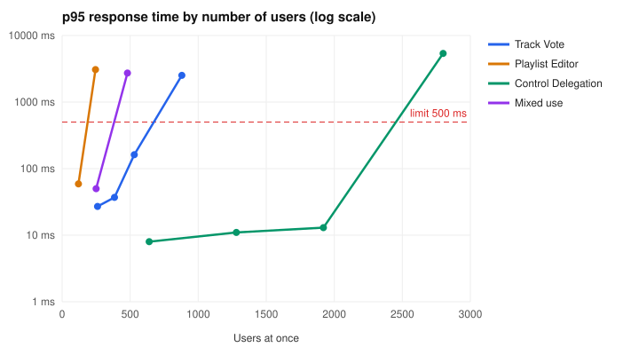
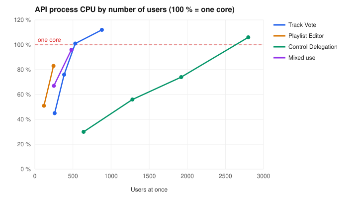

# Ramp-up

How many users the three services support at the same time, how it was measured, on which
machine, and what limits it.

## Machine

Everything ran on one machine: the API, the database and the load generator.

| Item | Value |
|---|---|
| Type | On premise, a laptop on mains power, performance power profile |
| CPU | Intel Core i5-13500H, 16 threads |
| RAM | 15 GiB |
| Disk | 512 GB NVMe SSD (Micron MTFDKCD512TFK) |
| OS | Linux 6.18 (x86_64), Docker 29.9 |
| API | One Node.js 22 process in a container (`make up`, `NODE_ENV=production`, built JavaScript) |
| Database | PostgreSQL 16.15 in a container, default settings (`max_connections` 100, `shared_buffers` 128 MB) |
| Connection pool | 10 connections from the API to PostgreSQL |
| Load generator | Artillery 2.0.34 on Node.js 26, same machine |

The load generator shares the CPU with the server, so the figures are a lower bound of what
the same server would do with the load coming from elsewhere.

## Method

- `make loadtest` runs one Artillery scenario per service plus a mixed one
  (`loadtest/*.yml`). Before each scenario it writes 2000 users into the database, each with a
  device, an access token, a friend and a control grant, plus one event with 40 queued tracks
  and one playlist with 40 entries. It removes them at the end.
- Every virtual user opens a Socket.IO connection with their own token, joins a room and
  then acts through the REST API or the socket, like the app does.
- Phases: 20 s warm-up at 2 new users per second, 90 s ramp up to the target rate, 40 s at
  the target rate. `LOADTEST_RATE` sets the target (`make loadtest LOADTEST_RATE=12`).
- A user stays about 32 s, so the number of users connected at the same time at the plateau
  is about `rate x 32`.
- A run passes when the 95th percentile of the response time stays under 500 ms and fewer
  than 1 % of the users fail. The rate was raised run after run until a run failed.
- The scenarios put every user in the **same** event or the **same** playlist. This is the
  worst case: all the load meets on one row lock and one broadcast room. Users spread over
  many events and playlists cost less per user.
- During each run, CPU and memory of both containers were sampled with `docker stats` and the
  open database connections with `pg_stat_activity`.
- The Deezer catalog is not part of the measure: tracks are written by the seed, and the
  mixed scenario searches five fixed queries that the API cache answers.

| Scenario | What a user does |
|---|---|
| `vote.yml` | Joins the event room, reads the state, then 8 times: vote for a random track, wait 2 s, remove the vote, wait 2 s |
| `playlist.yml` | Joins the playlist room, reads the entries, then 5 times: add a track, move it to the top, remove it, 2 s apart |
| `delegation.yml` | Lists the devices they can control, joins the remote of a friend's device, then 8 times: send a command, report their own device status, 2 s apart |
| `mixed.yml` | Profile, event list, playlist list, a search, friends, then 4 times: a vote, a playlist add and remove, a remote command |

## Results

Response times in milliseconds. "Users at once" is the plateau, `rate x session length`.





A run is "pass" when the p95 stays under 500 ms and fewer than 1 % of the users fail (see
Method); the failing runs say what failed.

### Music Track Vote (one event)

| New users / s | Users at once | Requests / s | p50 | p95 | p99 | API CPU | DB CPU | Result |
|---|---|---|---|---|---|---|---|---|
| 8 | 260 | 144 | 13 | 27 | 36 | 45 % | 35 % | pass |
| 12 | 385 | 208 | 15 | 37 | 61 | 76 % | 55 % | pass |
| 16 | 530 | 270 | 24 | 162 | 198 | 101 % | 86 % | pass |
| 20 | 880 | 277 | 257 | 2516 | 3072 | 112 % | 84 % | fail |

**About 530 users voting at the same time in one event.** Each of them votes every 2 s, which
is far more than people do at a party: the same server follows several times more people who
mostly watch the queue.

### Music Playlist Editor (one playlist)

| New users / s | Users at once | Requests / s | p50 | p95 | p99 | API CPU | DB CPU | Result |
|---|---|---|---|---|---|---|---|---|
| 4 | 120 | 68 | 22 | 59 | 74 | 51 % | 17 % | pass |
| 6 | 245 | 83 | 66 | 3072 | 3396 | 83 % | 20 % | fail |

**About 120 users editing the same playlist at the same time**, one edit every 2 s each.
Edits of one playlist are applied one after the other, so its throughput is capped by the
time of one edit (about 80 requests per second here), whatever the number of users. The
failing run has no error: every edit is applied, late.

### Music Control Delegation

Each user sends a command to a friend's device and reports the status of their own every
4 s. The response time is the one of the HTTP request that lists the controllable devices,
made while the socket traffic is at its plateau.

| New users / s | Users at once | Socket messages / s | p50 | p95 | p99 | API CPU | DB CPU | Result |
|---|---|---|---|---|---|---|---|---|
| 20 | 640 | 369 | 3 | 8 | 13 | 30 % | 11 % | pass |
| 40 | 1280 | 706 | 3 | 11 | 18 | 56 % | 19 % | pass |
| 60 | 1920 | 1044 | 3 | 13 | 22 | 74 % | 29 % | pass |
| 80 | 2800 | 1131 | 23 | 5379 | 5598 | 106 % | 39 % | fail |
| 160 | - | 1299 | 2276 | 6187 | 7557 | 102 % | 44 % | fail, 39 % of the users time out |
| 320 | - | 1301 | 2019 | 5827 | 7408 | 108 % | 48 % | fail, 67 % of the users time out |

**About 1900 users controlling a device at the same time.** Beyond it the process relays
about 1300 messages per second and no more. At every rate, including the last one, it stays
up and its memory stays under 250 MB.

### Mixed use

| New users / s | Users at once | Requests / s | p50 | p95 | p99 | API CPU | DB CPU | Result |
|---|---|---|---|---|---|---|---|---|
| 10 | 250 | 181 | 11 | 50 | 74 | 67 % | 33 % | pass |
| 15 | 480 | 242 | 13 | 2725 | 3328 | 96 % | 43 % | fail |

**About 250 users in a continuous session** made of browsing, searching and the three
services. The failing run has no error either: every request is answered `200`, late.

## Bottleneck

The API process. Node.js runs the application on one thread, and every failing run shows
that process at 100 % of one core while memory (under 250 MB), the 10 database connections
and the other 15 hardware threads are not exhausted. PostgreSQL comes second: it reaches
85 % of a core in the vote scenario, because one vote costs about six queries (permission,
entry, vote, version, the ranked queue, the caller's votes) and returns the whole state.

The server holds about 250 requests per second, or 1300 socket messages per second. The
number of users that represents depends on how often each one acts.

## What the measure changed

A first round of runs showed three weaknesses. They were fixed, and the tables above come
from the runs made after the fixes.

| Problem found | Before | Change | After |
|---|---|---|---|
| Playlist edits waiting for the row lock each held a database connection; with 10 of them waiting, every other request failed | At 8 new users / s: 656 answers `500` | Edits of one playlist wait their turn inside the API process and take a connection only when it is their turn; a saturated database answers `503` with `Retry-After` | No error at any rate: an overloaded playlist is slow, not broken |
| Every action started its own insert into the action log; under a flood of socket messages the pending inserts piled up in memory | At 320 new users / s: 4 GB of heap, process killed | The action log is written in batches from a bounded buffer; beyond it rows are dropped and counted | Same load: the process stays up under 250 MB; the log rows that do not fit are dropped and reported in the server log (none up to 60 new users / s) |
| The same search arriving many times at once called Deezer once per request, reaching Deezer's quota | At 15 new users / s in the mixed run: 820 answers `503`, 133 answers `502` | Identical searches in flight share one call | Same load: every answer is `200` |

## Consistency with the hardware

One laptop core serves a few hundred very active users of one room, or about two thousand
connected users who act every few seconds. That matches the scale given as a reference for this
kind of machine: thousands of users for a low-end server, far fewer on smaller hardware.

## Scaling path

1. **Several API processes** behind a load balancer use the idle cores. Requirements already
   identified in the code: the Socket.IO Redis adapter for broadcasts across processes, and
   Redis for the state now kept in memory (rate limits, login backoff, catalog cache,
   playback timers).
2. **A larger connection pool or PgBouncer** once several processes share the database.
3. **Cheaper votes**: return and broadcast only what changed instead of the whole queue.
4. **A read replica** for the discovery lists and searches.

## Reproducing

```bash
make install up                  # API, PostgreSQL and Mailpit in Docker
make loadtest LOADTEST_RATE=12   # the four scenarios, reports in loadtest/reports/*.json
```

Each report holds the response time percentiles, the request rates and the result of the two
pass criteria.
